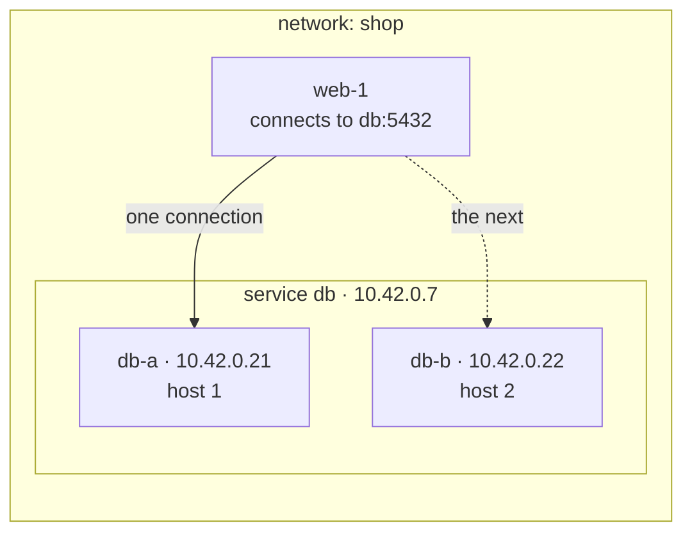

# sdn.sh

Per-workload network identity for short-lived workloads, across hosts in different places, with nothing on the path between two workloads able to read a packet.

Each workload gets an ordinary interface and ordinary sockets, its own key, and its own address for as long as it runs. Encryption happens at both edges in kernel WireGuard; the relays between hosts forward ciphertext and hold no key that can read or forge it.

**Status:** built — control plane, host agent, relay and CLI — and tested end to end on one machine, with the fleet benchmarks ready to run on EC2. [SPEC.md](SPEC.md) is the design and holds every measurement, [PLAN.md](PLAN.md) the phased build and what each phase has proven, [AGENTS.md](AGENTS.md) the working rules.

## Contents

- [In use](#in-use)
- [What sets it apart](#what-sets-it-apart)
- [What it doesn't](#what-it-doesnt)
- [Alternatives](#alternatives)
- [The shape of it](#the-shape-of-it)
- [How it works](#how-it-works)
  - [The interface](#the-interface)
  - [The relay](#the-relay)
  - [Services and selection](#services-and-selection)
  - [Policy](#policy)
  - [Leases and keys](#leases-and-keys)
  - [Convergence](#convergence)
- [Measured](#measured)
- [Known limits](#known-limits)
- [Development](#development)

## In use

You attach workloads to a service, and every workload that policy allows reaches them by the service's name.



1. Create a network. It costs nothing until something attaches to it.
2. Declare a service, `db`. It gets a name and an address that last as long as the service does.
3. Attach workloads to it. Each attach mints an interface with its own address and key, and the interface joins the service's backends.
4. Allow the flow: `allow web -> db tcp/5432`. Policy denies everything it does not name.
5. A workload attached to `web` connects to `db:5432` with an ordinary socket. The name resolves to the service address, and each new connection goes straight to one of `db`'s interfaces, chosen inside the client's own namespace, with no proxy or load balancer between them.

Replacing, adding or removing a `db` workload changes which interfaces stand behind the name. Clients keep dialing the same name and address.

## What sets it apart

- **A key per workload, scoped to a lease.** The agent mints a keypair at attach and discards it at detach, and every peer validates a decrypted packet's source against the addresses that key was granted, one per family. A host speaks as the interfaces it currently holds and as nothing else — not as one it used to hold, and not as one its neighbour holds. See [Leases and keys](#leases-and-keys).
- **Revocation runs through peers, not through the holder.** Removing a key from the peers that hold it makes an interface unreachable whether or not its own host cooperates, so a fence does not depend on reaching the thing being fenced. See [Leases and keys](#leases-and-keys).
- **Two networks can use the same addresses.** No translation, no tenant tag, no second encapsulation layer, because no two networks share a kernel object. See [The interface](#the-interface).
- **An interface per workload is affordable.** Kernel WireGuard costs a netdev and a peer table per interface rather than a userspace daemon, and a device created straight into the workload's namespace keeps its socket on the host, which takes the one operation that does not scale off the attach path. See [Measured](#measured).
- **Selection with no load-balancer hop.** A client picks a service's backend in its own namespace, in one nftables transaction, so no client ever sees a partial set of backends and established connections drain rather than break. See [Services and selection](#services-and-selection).
- **Service discovery without a discovery service.** Attaching a workload to a service registers it, and each client resolves the name through its own agent, so there is no Consul to run, no sidecar and no client library. A backend counts as healthy while its lease is live and its interface is up. See [In use](#in-use).
- **Nothing needs inbound reachability.** One relay port per direction of a policy edge, with endpoints learned from traffic, so workloads behind NAT that change public address on restart still work and NAT traversal never enters the picture. See [The relay](#the-relay).

## What it doesn't

**A relay that forwards ciphertext without holding a key is not unusual.** Tailscale's DERP, Nebula's relays and NetBird all do it. The measured advantage is against designs that terminate WireGuard in the middle — a gateway that decrypts and re-encrypts does two crypto operations per byte and becomes its network's ceiling — not against the better overlays. Treat the relay as table stakes and the identity model as the argument.

It is also not a lock, does not migrate connections, and runs on Linux hosts only. See [Known limits](#known-limits).

## Alternatives

| Option | Choose it when |
|---|---|
| **Tailscale** | You need one client on every OS, including laptops and Windows, with NAT traversal solved. Its userspace data plane costs a daemon per node, and DERP already relays ciphertext without keys. |
| **Nebula** | You want a mature, self-hosted mesh with host certificates and lighthouse discovery, and host-level identity is the right granularity. |
| **Netmaker / NetBird** | You want managed WireGuard between machines you administer, with a dashboard and gateways. |
| **Cilium cluster mesh** | Your workloads are Kubernetes pods and you want policy and identity inside that model. |
| **SPIFFE with a service mesh** | You want workload identity and mTLS at L7, you can change how applications dial, and you do not need overlapping L3 address spaces. |
| **A cloud VPC** | Every workload runs in one provider's region and you want no agent. |
| **Plain WireGuard, hub and spoke** | One operator, one network, a few hosts, and a gateway's throughput is enough. |

## The shape of it

```text
Network    address space, isolation boundary, policy, lifetime
Service    stable name and addresses; the unit you name and policy references
Interface  one attached workload: its own addresses, keypair and lease
Lease      a binding of (interface, public key, host) with a TTL
```

A service holds zero or more interfaces and its address outlives all of them. An interface's address lives exactly as long as its lease, so replacing a workload mints a new interface under the same service address: the service is what moves, the interface is what gets replaced.

A network holding no attached interface on a host costs that host nothing, so ten thousand networks are ten thousand control-plane rows and no kernel objects.

## How it works

### The interface

The agent mints the interface's keypair, then builds the whole data plane before the workload exists: a kernel WireGuard device created **directly into the workload's namespace**, one peer per policy-connected interface with that interface's addresses as its only `AllowedIPs` entries, then the addresses, routes, MTU, an nftables table and a stub resolver — and finally the namespace handed over without `CAP_NET_ADMIN`.

Creating into the namespace rather than creating and moving matters because the device records the *requesting* socket's namespace as the one its encrypted socket belongs to. The plaintext side lands in the workload while ciphertext leaves through the host, and the namespace move — which waits on an RCU grace period inside the RTNL lock, and so barely overlaps under concurrency — leaves the attach path entirely.

`AllowedIPs` carrying one address per family per peer is the identity enforcement: WireGuard validates the source of every decrypted packet against the sending peer's entry, so no peer can send as an address it was not granted. That the namespace is the unit of isolation is also why two networks can share an address space — nothing is shared between them to collide.

### The relay

One port per **directed** policy edge, so the port a packet arrives on names its sender. Each direction's endpoint is set only by an authenticated registration datagram, which the agent sends from the interface's own listen port, so it also holds the NAT mapping WireGuard uses. A data packet from the registered endpoint is forwarded to the peer direction's endpoint, sent from the peer direction's port — which is exactly where the receiver addresses the sender, so WireGuard's roaming keeps both sides pointing at the relay. A data packet never moves an endpoint.

Directed ports exist so the relay never has to recognise a sender by address. A host behind NAT has no outbound address the control plane can know in advance, many have none that is stable, and two interfaces can share one NAT address — which an address-based scheme cannot disambiguate at all.

No crypto, no conntrack, no per-flow state: one table lookup, one endpoint record, and a send. Reads and writes must be batched, because a per-packet syscall loop overflows its receive queue and carries less than a terminating gateway. Two interfaces on the same host skip the relay over loopback, still encrypted, and direct paths are an endpoint change rather than a different architecture.

### Services and selection

Because relays carry ciphertext, nothing in the middle can read an inner destination address, so selection happens in the client's own namespace:

```text
table inet sdn {
  map db_slots { typeof numgen random mod 1024 : ip daddr; }
  chain services {
    type nat hook output priority dstnat;
    ip daddr 10.42.0.7 tcp dport 5432 dnat to numgen random mod 1024 map @db_slots
  }
}
```

The slot count is fixed for the service's life, so a backend change replaces only the entries whose backend moved, atomically, and disturbs only its own slots. Conntrack pins each connection to its chosen backend and untranslates the replies, so the application sees responses from the address it dialed while the server replies from its own interface address — which is also its identity to the policy engine. A service address lives only in clients' namespaces: never assigned to an interface, announced, or routed.

### Policy

Policy is written against services and compiled per interface into a peer set and nftables rules, default deny. An interface receives a peer only where policy permits a flow, so **the policy graph is the peer graph** and an interface's peer count is its policy degree rather than the network's size. `AllowedIPs` answers whether a peer may speak as an address; nftables answers whether a flow may happen. Both run in the destination's kernel.

### Leases and keys

A lease binds `(interface, public key, host)` with a TTL the agent renews. The agent mints the keypair; the private half never leaves the host and the control plane only ever sees public keys.

Identity and confidentiality are separable, and only confidentiality depends on who holds the key. Because enforcement lives at the receiver, a host speaks as the interfaces it currently holds and as nothing else. The gain over a host-keyed mesh is scope and lifetime: authorization covers one interface for one lease instead of everything a host ever runs.

Revocation removes a key from its *peers*, so it needs nothing from the holder — which is also what lets an agent hold its configuration through a control-plane outage without weakening the fence.

### Convergence

A change produces one message per host holding a policy-connected interface, and each namespace applies it as a single transaction, with peer installation ordered around that transaction so every intermediate state is safe: add the peer before its slots, remove its slots before the peer. A revocation skips the grace period and removes both at once.

So a single-instance service flips atomically per client. Across clients the change is eventually consistent, and that window is the cost of a change.

## Measured

Every figure, its methodology, and the substrate that produced it live in [SPEC.md](SPEC.md#measured) — in one place, so they cannot drift. `cmd/hostbench` reproduces the kernel costs. What the measurements decided:

- **A device created directly into the workload namespace keeps its socket on the host**, verified by traffic rather than inspection: two devices created into two namespaces handshook through the host's loopback, and neither namespace has a path to the other. That removes the namespace move from the attach path, which is worth several times the attach rate.
- **Netdev concurrency depends on the operation.** Destroys overlap almost perfectly; namespace moves barely overlap at all, because a destroy defers its grace period past `rtnl_unlock` while a move holds RTNL across its own.
- **Peer installation runs under RTNL**, so it is one lane per host that does not widen with cores, and it serializes against device, address and route work. Removal costs from a quarter of an addition to about the same, depending on the host, so a detach is budgeted like an attach. That ceiling, not the device work, is what bounds attach rate.
- **Relaying ciphertext costs the middle box 2–3× less CPU per byte than terminating WireGuard** on the same machine against the same hosts. The throughput difference is small and noisy on the hardware tested, so the CPU cost is the result rather than the bandwidth.
- **Two networks on one address space** each reached their own peer at the same address, across NAT that gave the hosts different public addresses, and with two senders sharing one address.

## Known limits

- **Not a lock.** Address exclusivity and data exclusivity are different problems. A service needing a single writer fences in its storage layer.
- **A relay is trusted for availability.** It holds a per-direction secret to verify the agent's registration datagram, and nothing that decrypts or forges traffic, but it can still drop or misdeliver. Verifying a WireGuard handshake's `mac1` instead was considered and rejected, because a captured handshake replays from any address and at any relay.
- **One control plane orders every change.** Every write takes the next revision from one row, so attaches, releases and policy changes serialize across networks. Shorter transactions raise that ceiling; removing it is open.
- **The relay's socket model caps its edge count.** One socket per directed port puts a userspace process far below the port space. `sk_lookup` fixes only the receive side, so the real answer is XDP or TC.
- **A partition keeps an island alive.** A partition isolating a revoked interface together with some of its clients serves stale state until it reconnects.
- **No connection migrates.** A workload that moves breaks its established connections and clients reconnect.
- **IPv4 addresses and relay ports need a quarantine, on different clocks.** Every service has IPv6, where a network's `/64` never needs to reuse an address; IPv4 is opt-in per service because at 100 attaches a second a `/16` exhausts in about 11 minutes, so both IPv4 addresses and ports get reused. An address needs only the grace period plus convergence, provided each host removes the old peer and clears its conntrack and sockets first. Relay ports need to outlast stale senders, which makes them the scarcer pool.
- **Linux hosts, L3 only.** No broadcast, multicast or Ethernet-level attachment. A laptop or Windows host joins through a gateway interface.
- **A `CAP_NET_ADMIN` workload loses sender-side policy.** It keeps its identity, since the receiver enforces it, and loses only the local layer that would have stopped it from trying.
- **A flat network is bounded by arithmetic.** Relay ports scale with policy edges, so a fully connected network runs out long before a sparse one does. Segmenting it is the answer.
- **The MTU lever is path-dependent.** Raising the overlay MTU is worth several times the throughput per CPU, but only where the underlay carries large frames — within a datacenter, or between co-located interfaces. Across the internet the path stays near 1500 whatever the overlay asks for.

## Development

[SPEC.md](SPEC.md) is the design contract, [PLAN.md](PLAN.md) the phased build plan, [AGENTS.md](AGENTS.md) the working rules, and [deploy/README.md](deploy/README.md) the benchmark fleet.

| Program | What it is |
|---|---|
| `cmd/sdn-cp` | The control plane: networks, services, policy, leases, relays and edge ports over a transactional store, with long polls for agents and relays. `--store memory` or a Postgres URL. |
| `cmd/sdn-agent` | The host agent: builds each workload's namespace, device, peers, nftables table, stub resolver and egress link, renews leases, registers at relays and fails over between them. |
| `cmd/sdn-relay` | The ciphertext relay: one port per directed edge, batched reads and writes, endpoints moved only by authenticated registrations, persisted to its own disk. |
| `cmd/sdnctl` | The CLI: operator commands against the control plane, a development machine's config, and attach and detach through the local agent. |
| `cmd/sdn-sim` | The deterministic simulator: a seed draws a whole deployment, its faults and its workload, and replays exactly. |
| `cmd/sdn-lab`, `cmd/sdn-bench` | The benchmark driver and its load tool, against namespaces on this machine or a fleet on EC2. |
| `cmd/hostbench` | The kernel-cost harness behind every per-operation figure in the spec. Runs as root, names everything it creates `hb-*`, and sweeps only that prefix before starting. |
| `cmd/relay` | The prototype relay that learned endpoints from traffic, kept for the relay-against-gateway comparison. |

```console
go build ./... && go vet ./... && go test ./...      # unit tests, the determinism check, a simulator seed range
go run ./cmd/sdn-sim --seeds 10000 1                # a simulator sweep
scripts/ci all                                      # every CI step, root tests and end-to-end included
scripts/e2e -test.run TestTwoHosts                  # the daemons in namespaces, as root
scripts/lab run --env local --plan all              # every benchmark plan against this machine
go run ./scripts/mutants -root                      # plant each known bug and check a test catches it
```

Reproducing the measurements:

- **Kernel costs** need one Linux host with kernel WireGuard, namespaces and nftables, and root. The substrate is *not* incidental for anything bound by an RCU grace period: the same operations measured 2–3× apart between a KVM guest on 6.8 and a microVM on 6.18, in both directions. Report which.
- **Throughput** needs three machines in one datacenter and a plain-TCP underlay ceiling measured in the same run. Without the ceiling the numbers mean nothing — a path that reads as a design limit is often 95% of the network. A cross-region relay reports the geography instead.
- **The relay-against-gateway comparison** must run both roles on the same machine against the same hosts, or it compares hardware rather than architectures.
- Raise `net.core.rmem_max` before measuring the relay, or its receive buffer is silently capped, and watch `nstat -az | grep -i UdpRcvbufErrors` — a climbing count means it is dropping and every figure below it measures that.
- **Purge stray state between runs.** `ip netns del` only removes the name: a namespace a process still holds keeps its WireGuard device alive and keepaliving, which will quietly claim a relay direction and contaminate the run. Check `/proc/*/ns/net` for namespaces outside the host's.
