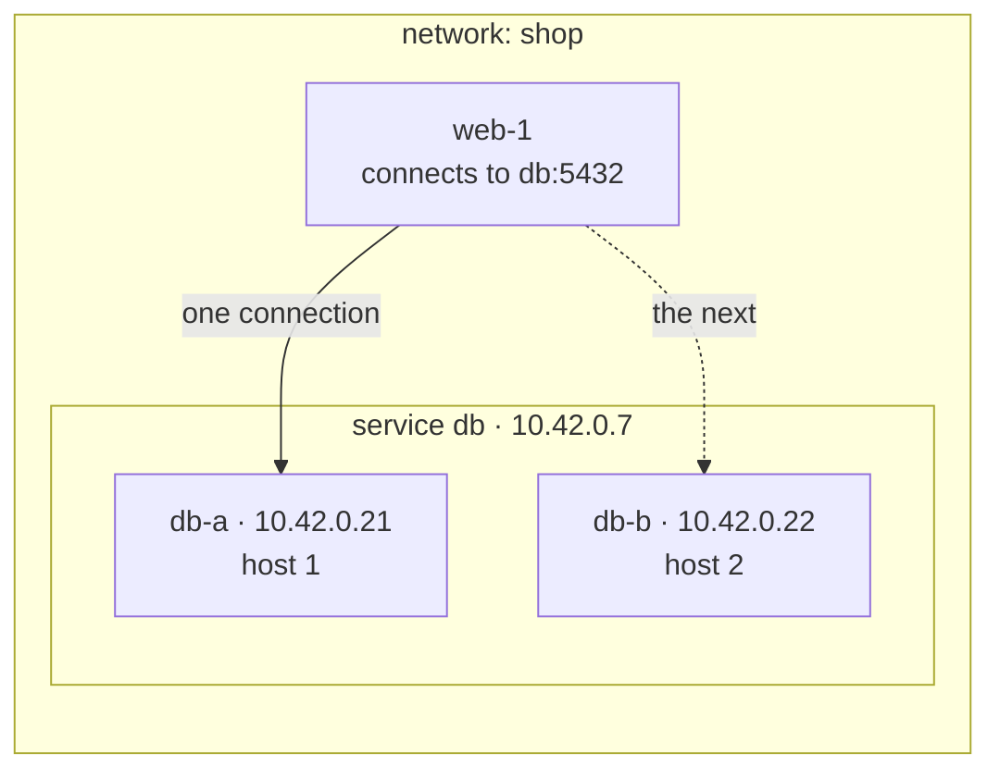
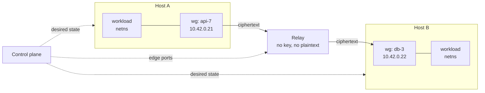

# sdn.sh

Per-workload network identity for short-lived workloads, across hosts in different places, with nothing on the path between two workloads able to read a packet.

A network is an isolated address space. A service is a stable name and address within it. An interface is a leased, cryptographically identified attachment that belongs to a workload rather than to the host running it. Encryption happens at both edges in kernel WireGuard; the relays between hosts forward ciphertext and hold no key.

**In use:** you attach workloads to a service, and every workload that policy allows reaches them by the service's name.



1. Create a network. It costs nothing until something attaches to it.
2. Declare a service, `db`. It gets a name and an address that last as long as the service does.
3. Attach workloads to it. Each attach mints an interface with its own address and key, and the interface joins the service's backends.
4. Allow the flow: `allow web -> db tcp/5432`. Policy denies everything it does not name.
5. A workload attached to `web` connects to `db:5432` with an ordinary socket. The name resolves to the service address, and each new connection goes straight to one of `db`'s interfaces, chosen inside the client's own namespace, with no proxy or load balancer between them.

Replacing, adding or removing a `db` workload changes which interfaces stand behind the name. Clients keep dialing the same name and address.

**Best fit:** many short-lived, isolated workloads per host — agent sandboxes, preview environments, per-tenant application stacks, CI jobs — where networks are created and destroyed by programs rather than by people.

**What it buys:**

- **Identity per workload, scoped to a lease.** Each interface holds a keypair the agent mints at attach and discards at detach, and every peer validates a decrypted packet's source against the addresses that key was granted, one per family. A host speaks as the interfaces it currently holds and as nothing else, and revoking a lease removes the key from its peers rather than asking the holder to stop.
- **Overlapping address spaces at no cost.** Two networks both using `10.42.0.0/16` need no translation, no tenant tag, and no second encapsulation layer, because no two networks share a kernel object.
- **Density.** Kernel WireGuard costs a netdev and a peer table per interface rather than a userspace daemon, which is what makes an interface per workload affordable at thousands per host.
- **Service discovery without a discovery service.** Attaching a workload to a service registers it, so the control plane already knows every service's backends and pushes them to the hosts that need them. A client resolves the name through the agent's stub resolver and connects with an ordinary socket, with no Consul, sidecar or client library. A backend counts as healthy while its lease is live and its interface is up; application health checks are out of scope.
- **Selection without a load-balancer hop.** A client picks a service's backend in its own namespace, so a service address needs nothing in the middle to resolve it.
- **Change that lands in one step per client.** Each namespace applies a service change as a single nftables transaction, so no client observes a partial set of backends, and established connections drain rather than break.
- **Throughput per resource against a terminating gateway.** A gateway that decrypts and re-encrypts does two crypto operations per byte and becomes its network's ceiling. Relaying ciphertext instead is measurably cheaper; see [Measured](#measured).

**What it does not buy:** a relay that forwards ciphertext without holding a key is not unusual. Tailscale's DERP, Nebula's relays and NetBird all do it. The comparison that favors this design is against designs that terminate WireGuard in the middle, not against the better overlays.

## Alternatives

| Option | Choose it when |
|---|---|
| **Tailscale** | You need one client on every OS, including laptops and Windows, with NAT traversal solved. Its services give a stable address several nodes advertise; its userspace data plane costs a daemon per node, and DERP already relays ciphertext without keys. |
| **Nebula** | You want a mature, self-hosted mesh with host certificates and lighthouse-mediated discovery, and host-level identity is the right granularity. |
| **Netmaker / NetBird** | You want managed WireGuard between machines you administer, with a dashboard and gateways. |
| **Cilium cluster mesh** | Your workloads are Kubernetes pods and you want policy and identity inside that model. |
| **SPIFFE with a service mesh** | You want workload identity and mTLS at L7, you can change how applications dial each other, and you do not need overlapping L3 address spaces. |
| **A cloud VPC** | Every workload runs in one provider's region and you want no agent. |
| **Plain WireGuard, hub and spoke** | One operator, one network, a few hosts, and a gateway's throughput is enough. |

## Model

```text
Network    address space, isolation boundary, policy, lifetime
Service    stable name and addresses; the unit users name and policy references
Interface  one attached workload: its own addresses, keypair and lease
Lease      a binding of (interface, public key, host) with a TTL
```

A service holds zero or more interfaces, and its address outlives all of them. An interface's address lives exactly as long as its lease, so replacing a workload mints a new interface with a new address and key under the same service address — the service is what moves, the interface is what gets replaced.

A network holding no attached interface on a host costs that host nothing. Creating ten thousand networks is ten thousand control-plane rows and no kernel objects.

## Architecture

### Components

- **Control plane.** The only stateful component. Stores networks, services, interfaces, leases, policy, and relay assignments. It sits outside the data path: losing it freezes change and does not stop traffic.
- **Host agent.** One per host. Mints interface keys, creates and configures kernel WireGuard devices, installs policy, serves name resolution, renews leases, and reconciles kernel state against pushed desired state.
- **Relay.** A UDP forwarder with one port per directed policy edge. Holds no key and sees no plaintext.



### Address space

Every network has an IPv6 prefix, by default a ULA `/64`, and may also declare an IPv4 prefix. Spaces overlap freely between networks because no two networks ever share a kernel object.

**Every service has IPv6; IPv4 is opt-in per service.** A service that opts in gets an IPv4 service address, and every interface it holds gets an IPv4 address beside its IPv6 one. Family belongs to the service rather than to the interface because translation cannot cross families: an IPv4 service address translates only to IPv4 backends, and every slot in its map must carry one. A flow uses IPv4 only between two services that both have it. Which family a client dials is up to its resolver library, so policy and selection behave identically in both.

Service and interface addresses come from one pool per family and are unique within the network, so an address means the same thing in every namespace that sees it and a capture needs no context to read. IPv6 never runs short: a `/64` lets the allocator avoid reusing an address for the life of the network. IPv4 does, which is why it is opt-in. An IPv4 prefix wants a `/16` or larger, and even that is tight under churn: at 100 attaches a second a `/16` exhausts in about 11 minutes, so IPv4 addresses have to be reused.

| Purpose | Lifetime | Appears on |
|---|---|---|
| Interface address | The lease, plus quarantine | That interface, and in peers' `AllowedIPs` |
| Service address | The service | No interface anywhere |

**A released address and its relay ports stay quarantined**, but for different reasons and on different clocks.

An address does not need to outlast a partition. A peer that has yet to converge still holds the *old* key, and keys are not reused, so it cannot reach whoever holds the address next. The hazards are local to each host: installing a peer whose `AllowedIPs` contains an address silently moves that address away from the peer that held it, and conntrack entries translated to it outlive the peer entirely. Both are fixed by ordering — on every host, remove the old peer, flush its conntrack entries and destroy the sockets addressed to it before any new peer may claim the address — which leaves the address quarantine only needing to cover the grace period plus convergence.

Relay ports do need the long quarantine, because a stale sender keeps sending to the old port whatever the control plane has done. That makes ports the scarcer pool; see [The relay](#the-relay).

A service address exists only in clients' namespaces as a translation target. It is never assigned to an interface, never announced, and never routed, so service addresses can be minted freely and cannot conflict with a workload's own configuration.

The underlay may be IPv4 or IPv6 independently of the overlay, so either overlay family runs over either underlay.

### The interface

The host agent builds the whole data plane for a workload before the workload exists, then hands over a finished namespace:

1. Mint the interface's keypair. The private half never leaves the host, and the control plane is told only the public half.
2. **Create the kernel WireGuard device directly into the workload's namespace**, with `IFLA_NET_NS_FD`. The device records the *requesting* socket's namespace as the one its encrypted UDP socket belongs to, so the plaintext side lands in the workload's namespace while ciphertext leaves through the host, with no move ([WireGuard namespaces](https://www.wireguard.com/netns/)).
3. Set the private key and a fixed listen port.
4. Install one peer per policy-connected interface: its public key, its endpoint, and as the only entries in `AllowedIPs`, its address in each family both interfaces have.
5. Assign the interface's addresses, route the network's prefixes through the device, and set the MTU explicitly.
6. Install the nftables table: service translation, policy, and MSS clamping.
7. Open a stub resolver socket on loopback inside the namespace, served by the agent.
8. Hand the namespace to the workload **without `CAP_NET_ADMIN`**.

Creating into the namespace rather than creating and then moving is worth 6.3× on attach, because a namespace move waits on an RCU grace period inside the RTNL lock and so barely overlaps under concurrency. See [Measured](#measured).

`AllowedIPs` carrying one address per family per peer is the identity enforcement: WireGuard validates the source address of every decrypted packet against the sending peer's entries, so no peer can send as an address it was not granted. It also keeps the cryptokey table unambiguous: WireGuard keeps one trie per family (`drivers/net/wireguard/allowedips.h`), and each resolves an address to exactly one peer.

The namespace is the unit of isolation, so the model applies wherever a workload can be put in one: a container, a VM, or a bare process under `ip netns exec`. For a microVM or VM behind a TAP, the interface address belongs to the **guest**, not to the namespace — addressing the namespace instead would capture the guest's own packets — so the namespace routes between the TAP and the WireGuard device rather than terminating the address.

### The relay

A relay forwards outer UDP packets. **One port per directed policy edge**, on every relay in the network's set, so the port a packet arrives on names its sender. Each direction learns one endpoint from the packets arriving on its own port:

```text
pushed:   port -> its peer port, the interface entitled to send on it,
                  and that direction's registration key for this relay
state:    port -> the endpoint its last accepted registration named,
                  and the highest counter accepted
```

A packet arriving on port `P` from endpoint `E`:

1. An unknown `P` drops.
2. A registration datagram is verified against the direction's key and counter. On success it sets this direction's endpoint to `E`, and is consumed rather than forwarded.
3. Any other packet is forwarded from the peer port's socket to the endpoint the peer direction last registered, and is dropped while that side has yet to register or while `E` is not the registered endpoint.

So a data packet never moves an endpoint. Only a registration does.

Sending from the peer port is what makes the return path work without configuration: the receiver sees the packet arrive from exactly the port it addresses the sender at, so WireGuard's roaming keeps both sides pointing at the relay.

**Directed ports exist so that the relay never has to recognise a sender by address.** A host behind NAT has no outbound address the control plane can know in advance, and many have none that is even stable — a microVM substrate that reassigns a public address on each resume is common. Two interfaces can also share one NAT address, which an address-based scheme cannot disambiguate at all. Doubling the ports per edge buys exactness.

Both sides register before any application traffic, because each agent sends a registration datagram for every direction as it installs the peer. A side that has yet to register costs one dropped handshake and a retry.

Consequences:

- **No crypto, no conntrack, no per-flow state.** One table lookup, one endpoint record, and a send. Reads and writes must be batched through `recvmmsg`/`sendmmsg`: a per-packet syscall loop overflows its receive queue and carries less traffic than a terminating gateway, which removes the reason to relay at all.
- **An endpoint change is admitted only by an authenticated registration datagram.** The agent sends one to the active relay and to every standby, carrying the direction, a monotonic counter, and a MAC over all of it *plus the relay address and port*. Three properties the design depends on:
  - **The key is derived per relay**, from the direction's secret and that relay's identity, and each relay receives only its own. A single shared secret would let a compromised relay compute valid registrations for its peers by naming their address in the MAC.
  - **The counter survives restarts at both ends.** The relay persists the highest counter it has accepted per direction; the agent derives its counter from a clock rather than from a variable that resets. Otherwise a relay restart reopens replay, and an agent restart locks the agent out of its own direction.
  - **It is sent on change, not only on a timer.** The periodic interval is 25 seconds, under common NAT UDP timeouts and the figure `wg(8)` recommends for keepalive, because on the relay path this datagram is the only thing holding the NAT mapping open. A periodic send alone would leave recovery waiting up to that long after a resume or an address change, so the agent also sends immediately when its underlay address changes and on resume. The steady cost is edges × relays ÷ interval.
  Verifying a WireGuard handshake's `mac1` is **not** sufficient and was rejected: `mac1` is a fixed MAC over the message bytes, covers no destination, and the timestamp that would make it fresh is encrypted, so a captured initiation replays from any address and at any relay — and every peer of the receiver already knows the public key that keys it, so an insider forges outright.
  A packet that loses an endpoint race is dropped rather than forwarded, so the relay cannot be used as a reflector.
- **A relay persists what it is pushed.** Its port table and per-direction secrets survive a restart, or a relay that comes back during a control-plane outage strands every edge it serves.
- **A restart costs at most one registration interval**, after which both directions have registered again.
- **Zero added bytes**, so the overlay MTU accounts for WireGuard overhead alone.
- **No key, no plaintext, ever.** A relay can be run by someone the workloads' owner does not trust with data.

A relay carries several addresses, so the table keys on `(local address, port)`. Two limits bind, and both are tighter than they look:

- **Port supply, under churn.** Ports have to stay quarantined after an edge goes away, because a stale sender keeps sending to the old port. At 100 attaches a second with an average degree of 10, two directions each, and a five-minute quarantine, that is 600,000 live ports — more than eight IPv4 addresses supply. An IPv6 relay address space or authenticated registration that makes early reuse safe is what relieves it.
- **Socket count.** A userspace relay opens a socket per directed port, so one process serves thousands of edges rather than the hundreds of thousands the port space allows. `sk_lookup` fixes the receive side only; sending from the peer direction's port still needs a socket bound to it or a raw socket, so the userspace route is `sk_lookup` plus raw sends, while XDP or TC handles both in one place. This is a correctness requirement for the stated scale, not a speedup.

Edge ports are allocated on **every** relay in a network's set up front, because an agent can only fail over to a relay it already has an address for.

**Standby registration needs its own packet, because kernel WireGuard sends to one endpoint per peer.** The agent sends the registration datagram above to the active relay and to every standby once per registration interval, from a raw socket bearing the interface's own listen port so the NAT mapping it creates is the one real traffic will use. The relay recognises these by their MAC and keeps them out of forwarding. Admission and failover are therefore one protocol rather than two features, which is why it has to be settled before the relay is built rather than after. Moving an edge between relays is safer than a service change, because both paths deliver throughout: allocate, push, repoint, then free the old ports after convergence.

### Paths

An interface reaches a peer by one of three paths, chosen by setting the peer's endpoint. Keys, addresses, and policy are identical in all three, so the path is an optimization rather than a mode.

| Path | Endpoint | When |
|---|---|---|
| **Loopback** | `127.0.0.1:<peer's listen port>` | Both interfaces are on the same host. Both UDP sockets live in that host's namespace, so the packet never leaves it and stays encrypted. |
| **Relay** | `relay:<this direction's port>` | The default. No inbound reachability required at either end, so NAT traversal is unnecessary. |
| **Direct** | the peer's host endpoint | Both ends are reachable, directly or after hole punching. Zero added hops. |

Kernel WireGuard holds exactly one endpoint per peer, so failover is the agent's job: it probes its network's relays and rewrites endpoints through `wgctrl` when one stops answering. Target sub-second failover from a 200 ms probe interval. Anycasting a relay address moves failover into the network and is a later option.

**Roaming owns the endpoint, so the reconciler must not treat a roamed endpoint as drift.** Any authenticated packet from a new source rewrites it, which is the mechanism the relay path depends on. An agent that "corrects" the endpoint back to its desired value will fight the data plane.

**`persistent-keepalive` is set per path:**

| Path | Keepalive | Why |
|---|---|---|
| **Relay** | None | The registration datagram already registers each direction at the relay, and because it leaves from the interface's listen port for the same relay port, it holds the NAT mapping open too. |
| **Loopback** | Exactly one side | Keeps a session up and gives one side every rekey, so the pair cannot collide. See below. |
| **Direct** | Both sides, or an equivalent agent probe | Holds the NAT pinhole, which nothing else does on that path. |

Leaving keepalive off relay peers makes an idle peer free: it sends nothing and never rekeys, since WireGuard rekeys on a timer only for the side that initiated the session, and only when it sends (`drivers/net/wireguard/send.c`). The cost is one handshake round trip on the first packet after a session idles past its 180-second lifetime (`messages.h`), a few milliseconds through an in-region relay. It also removes a collision at attach. Arming keepalive on a running device sends a packet at once (`netlink.c`), and both agents install a new edge within milliseconds of each other, so two armed peers each initiate immediately; initiations that cross within the relay's one-way latency cancel each other and cost a 5-second round, more than the attach target allows. Without keepalive, only the side with traffic initiates.

This rests on a raw-socket registration datagram refreshing the same NAT mapping that WireGuard's own socket uses. A NAT keys its mappings on addresses and ports rather than on the sending socket, so it should, but Phase 3 tests it before relay peers go without keepalive.

The loopback path makes co-location a real placement objective: two services that talk constantly cost nothing to connect when scheduled together.

**On the loopback path, at most one side initiates.** One agent configures both ends of a co-located pair, so if both peers carry `persistent-keepalive` they initiate at the same instant. Each answers the other's initiation, which discards its own pending handshake, and both responses come back invalid. WireGuard retries after 5 seconds plus up to 333ms of jitter (`drivers/net/wireguard/timers.c`), but at `HZ=1000` a timer that far out sits in a timer-wheel level that rounds expiry to 512ms (`kernel/time/timer.c`), so the two retries usually fire on the same tick again. On Linux 7.0 a pair stayed in that lockstep for minutes. So the agent arms keepalive on exactly one side of a co-located pair, chosen deterministically, such as the interface with the lower ID. That side keeps a session up and owns every rekey, so the other side always finds a valid session and never initiates. Leaving both sides bare would let two workloads that start sending at the same instant after an idle period fall into the same lockstep. Peers on different hosts keep separate clocks and do not lock together this way, though a simultaneous first initiation can still cost a 5-second round.

### Service addresses and selection

Because relays carry ciphertext, nothing in the middle can read an inner destination address. Selection therefore happens in the client's own namespace, which removes the load balancer hop entirely.

The agent installs, per service the client may reach:

```text
table inet sdn {
  map db_slots { typeof numgen random mod 1024 : ip daddr; }
  chain services {
    type nat hook output priority dstnat;
    ip daddr 10.42.0.7 tcp dport 5432 \
      dnat to numgen random mod 1024 map @db_slots
  }
}
```

The slot count is fixed for the life of the service, which is what makes a backend change cheap:

- **A backend is one interface**, one attached workload. A single-instance service owns every slot; five replicas own a fifth each, wherever they run. A backend's weight is how many slots it holds.
- **The declaration uses `typeof` on both sides.** `typeof <key expression> : ip daddr` is the form nftables accepts. Naming a value type (`: ipv4_addr`) or an unqualified `type integer` key are both rejected, the second with advice to use `typeof`. The IPv6 form is analogous and unverified.
- **An IPv4-capable service has one map per family.** A map's values are all one family, so the agent installs an IPv6 map and an IPv4 map, and both assign each slot to the same backend. A backend's weight is then the same whichever family a client dials, and one transaction changes both maps.
- **The map always holds every slot**, and a change replaces only the entries whose backend moved. `delete element` and `add element` in one nftables batch apply atomically. A slot with no entry leaves the packet addressed to the service address, which goes nowhere, so a partially filled map is never written.
- **Removing a backend disturbs only its own slots**, because the slot table is the indirection layer.
- **A service with no backends rejects** rather than blackholing: the agent installs a reject rule for the service address instead of a translation, so a client fails fast rather than hanging.
- **The ceiling is the slot count**, which you pick. 1024 is past any real replica count, and a map that size is trivial for the kernel.

A namespace holding a forwarding workload, such as a microVM behind a TAP, gets the same rules in the `prerouting` hook.

- **Selection is per connection.** Conntrack pins the first packet's choice for the life of the flow, for TCP and UDP alike. `numgen random` draws each connection's slot independently (`nft_ng_random_gen`, `net/netfilter/nft_numgen.c`), so a backend's share converges on its slot count, and it has no affinity to disturb. `numgen inc` reads as round-robin but concentrates load: each rule owns its counter and starts it at slot 0 (`nft_ng_inc_init`), so every client namespace begins on the same backend, and short-lived clients that open a few connections never leave it. On nftables 1.0.9 and Linux 6.10, twenty fresh namespaces opening one connection each all reached one backend under `inc` and split 8 and 12 under `random`. A map declared `typeof jhash ip saddr mod 1024 : ip daddr` keys selection to the client instead, which preserves affinity across reconnects and, because the slot table absorbs the change, moves only a departing backend's share — consistent-hash behavior, but only in the `jhash` form. Affinity holds within one family, since a client's IPv4 and IPv6 addresses hash to different slots. `numgen random` is the default because `nft list` segfaults while printing a `jhash`-keyed map on nftables 1.0.9: the ruleset works and the inspection tool crashes.
- **Replies need no reverse lookup.** Conntrack untranslates them, so the application sees responses from the service address it dialed.
- **The server never learns the service address.** It replies from its own interface address, which is also its identity to the policy engine. Incoming and outgoing identity are the same thing.
- **Names resolve to service addresses** through the stub resolver on loopback, answered from pushed state. It answers AAAA for every service and A only where both the client's service and the target have IPv4, so no client receives an address it cannot reach. Because the agent serves it, an agent restart interrupts name resolution for every workload on the host. Persisting the resolver's state shortens that outage but does not remove it, since the listening sockets close with the process: the file descriptors are handed across restarts instead, through a descriptor store.

### Policy

Policy is written against services and compiled per interface:

```text
allow api -> db     tcp/5432
allow web -> api    tcp/8080
allow api -> internet tcp/443
```

Compilation produces two things, and default is deny:

- **A peer set.** An interface receives a peer only where policy permits a flow. **The policy graph is the peer graph**, so an interface's peer count is its policy degree rather than the network's size. Peer count costs memory always, and handshakes only where traffic flows. A relay peer carries no keepalive, so an idle one sends nothing and never rekeys; a busy one rekeys about every two minutes, so 2,000 busy peers cost about 17 handshakes a second. Each co-located pair adds one rekey every two minutes from its keepalive side.
- **nftables sets in the receiving namespace.** Which flows are permitted, by service-grouped address set and port. A set holds one family, so the compiler emits each in every family the two services share, and a rule permits the same flows in both. Installed before handover and unreachable from inside, so the workload cannot remove them.

`AllowedIPs` answers "may this peer speak as this address." nftables answers "may this flow happen." Both run in the kernel at the receiver, so removing the relay from the trust path costs no enforcement.

**Attach latency grows with policy degree.** Peers install at roughly 130µs each in one batched call, so an interface joining a fully connected 2,000-interface network waits about 250 ms for its own peer table before it can talk to anyone. Dense policy is expensive at attach even when it is affordable at steady state.

**Internet egress is a separate grant, and it is the one case where a namespace has a second way out.** The agent adds a veth pair to the host namespace and NATs there; without the grant no such path exists, which is what gates egress. The filter lives in the **host** namespace, on that veth, and must drop at least the link-local ranges (`169.254.0.0/16` and `fe80::/10`) and the metadata service in both families (`169.254.169.254`, and on EC2 also `fd00:ec2::254`), **the host's own addresses**, the underlay prefix, every relay address, and private ranges the network has not been granted. The host itself matters as much as the rest: the veth's host end otherwise reaches host services and every co-located interface's WireGuard listen port, where a flood of handshake initiations costs the host a Curve25519 operation each. A workload that can reach the relays can attack endpoint registration.

The veth carries per-host addresses outside the network's prefixes, in whichever families the host can route, so a service without IPv4 still reaches the IPv4 internet. IPv6 egress is masqueraded like IPv4, because the network's IPv6 addresses are ULAs.

### Development machines

A developer joins a network from a laptop with a stock WireGuard client, such as the macOS app or `wg-quick`, by importing a generated config. The laptop becomes an interface like any other, with its own key, addresses and lease, and policy names it like any other.

```ini
[Interface]
PrivateKey = <minted on the laptop>
Address = fd8a:2c41:7e09::51/128, 10.42.0.51/32
DNS = fd8a:2c41:7e09::3, shop.internal
MTU = 1380

[Peer]
PublicKey = <the gateway interface's public key>
Endpoint = gw.example.com:51820
AllowedIPs = fd8a:2c41:7e09::/64, 10.42.0.0/16
PersistentKeepalive = 25
```

- **The laptop mints its own key.** The tool that writes the config generates the keypair locally and registers only the public half, so the control plane still sees public keys only. A web page can do the same in the browser.
- **The laptop has one peer: a gateway interface.** A stock client holds a static peer list and runs no agent, so it can neither follow backends as they churn nor translate service addresses itself. It peers with a gateway instead: an agent-managed interface on a Linux host that routes the network's prefixes. The config stays valid as backends come and go.
- **The gateway translates and forwards.** It translates service addresses in its `prerouting` hook, as any forwarding namespace does, and forwards to the backend with the laptop's own address as the source. Each backend's peer entry for the gateway carries the addresses of the laptops it fronts, the one peer entry that holds more than its own addresses, so receivers enforce policy against the laptop's address like any other source. The gateway's own peer entry for each laptop stops one laptop sending as another.
- **The laptop dials the gateway directly.** A stock client cannot send the relay's registration datagram, so the gateway host exposes one inbound UDP port, and the laptop's keepalive holds its own NAT mapping open.
- **The gateway serves names.** The `DNS` line points at a resolver the agent serves on the gateway's address, answering the network's names and forwarding everything else, and the search domain lets `db` resolve on the laptop as it does in a workload.
- **The lease has a fixed term.** No agent renews it, so the control plane issues it with an expiry and the developer regenerates the config to extend it. Revocation removes the laptop's peer from the gateway and its addresses from the backends' entries, with no grace period.
- **IPv6 keeps the laptop's routes clean.** ULA prefixes are random, so a network's IPv6 prefix collides neither with another network's nor with the laptop's own LAN. Two networks with overlapping IPv4 prefixes cannot both be routed on one laptop.

The gateway decrypts the laptop's traffic and re-encrypts it toward backends, the terminating hop the design avoids for workloads. A developer's traffic needs reach rather than throughput, so the cost is acceptable here, and the laptop trusts the gateway's host the way a workload trusts its own.

### Leases and keys

A lease binds `(interface, public key, host)` with a TTL the agent renews. **The host agent mints the keypair**; the private half never leaves the host and the control plane only ever sees public keys. The key is minted at attach and discarded at detach, and no key is ever reused.

**The lease is the key binding.** Revoking it means removing that public key from every peer that holds it, which is a data-plane fence rather than a database state. A host that no longer holds the lease holds a key that no peer will accept.

**Identity and confidentiality are separable, and only confidentiality depends on who holds the key.** Enforcement lives at the receiver, where every peer validates a decrypted packet's source against its own `AllowedIPs` entry for that key, so a host speaks as the interfaces it currently holds and as nothing else. The gain over a host-keyed mesh is scope and lifetime: authorization covers one interface for one lease instead of everything a host ever runs.

A guest-owned variant, where an agent inside a microVM mints and holds the key so the host carries only ciphertext, adds confidentiality from the host. It costs an agent in every workload, so it stays a later tier for VM workloads. Because the control plane already accepts a public key it did not generate, adding it needs no protocol change.

**Revocation does not need the holder's cooperation, and it skips the removal grace period.** A key is removed from its *peers* immediately, so a revoked interface reaches nobody that converged, whatever its own host still has configured. The grace period in [Convergence](#convergence) applies to a planned removal, never to a revocation.

Lease expiry makes an interface unreachable. It does not stop the workload, which may keep running and keep serving a client that has yet to converge. A partition isolating a revoked interface **together with** some of its clients keeps the old topology alive inside that island, so a zone cut off from the control plane serves stale state until it reconnects.

### Convergence

Steady-state traffic involves no lookup and no control-plane participation. A change to a service produces one update per host holding a policy-connected interface.

**The control plane pushes to hosts, not to namespaces.** One message per host carries the deltas for every namespace on it, and the agent applies them as a batch of netlink operations. Fan-out therefore scales with the fleet rather than with the network:

```text
control-plane load = hosts_in_network x change_rate
per-host work      = affected namespaces on that host, netlink operations per batch
```

**Peer work runs under RTNL and is therefore one lane per host.** `wg_set_device` takes `rtnl_lock()` before the per-device lock and holds both for the whole call, the Curve25519 precompute included; reading device state takes the same locks. So peer changes serialize against each other *and* against device creation, address, route and link changes — against anything on the host that uses RTNL.

```text
~10,000-12,000 peer operations per second, per host, and it will not grow with cores
```

Measurement only sizes that ceiling; the source decides the shape. One to two writers reach it, and a single writer batching ten peers per call reaches the same figure alone.

An attach of an interface with policy degree D costs D peer operations on its own device plus one on each of D neighbours' devices. Those neighbour additions parallelize **only across hosts** — on one host they queue on RTNL. A removal costs between a quarter of an addition and about the same, depending on the substrate, so budget a detach like an attach.

A 2,000-interface fully connected network remains unworkable, for the plainer reason that its edges need roughly four million directed relay ports. Dense policy is a design error rather than a scaling target.

**A per-call peer cap is not the lever it looks like.** `wgctrl` already splits any config over 32 peers into separate messages, so a cap above that never takes effect and RTNL is released between chunks. What hurts is a tight loop winning an unfair mutex, so the fix is to yield between chunks or bound how many writers run at once. An agent that bypasses `wgctrl` and packs many peers into one message would hold RTNL for the whole message, which is the thing to avoid. Creating a network or a service touches no host at all; only attachment does.

**Each namespace applies a change in one step.** nftables applies a batch as a single transaction, so no client ever observes a partial backend set. Peer installation and removal are ordered around that transaction so the intermediate state is always safe:

| Change | Order | Intermediate state |
|---|---|---|
| **Add an instance** | Install peer, then add its slots | Peer exists, receives nothing |
| **Remove an instance** | Remove its slots, then after the grace period remove the peer, flush the conntrack entries translated to its addresses, and destroy the sockets addressed to it | Peer exists, takes no new flows; established flows finish |
| **Replace an instance** | Install new peer, swap the slots in one transaction, then after the grace period remove the old peer, flush its conntrack entries and destroy the sockets addressed to it | New connections go to the new instance; established connections stay with the old one |
| **Revoke an instance** | Remove its slots, its peer, its conntrack entries and its sockets together, no grace | The interface is unreachable at once |

Neither the conntrack flush nor the socket teardown is optional. An established TCP entry translated to an interface's address is tracked for days, so a flow left behind would keep delivering to whichever interface next holds that address — and flushing conntrack does not close the **socket**, so an application that writes to it afterwards still sends to the new holder. Removing a peer therefore also destroys the sockets addressed to it, the way `ss -K` does through `SOCK_DESTROY` — which needs `CONFIG_INET_DIAG_DESTROY`, so the agent checks for it at startup and refuses to run without it rather than silently leaking flows. Workloads are additionally denied `CAP_NET_RAW`, which container runtimes commonly grant by default and which would otherwise let the new holder read what arrives.

So a single-instance service flips atomically per client, and established connections drain rather than break. `cutover` mode evicts the conntrack entries instead, breaking them immediately.

Across namespaces the change is eventually consistent, and the window is the push latency. **This is the cost of a change**, and it is the figure to design and report against. Note that it bounds a different thing from attach latency: an attach can finish locally in milliseconds, but a first packet to a *remote* peer cannot arrive before that peer's host has converged, so the two targets measure different things and the convergence window dominates.

During that window, clients disagree. For a single-instance service, some clients talk to the old instance and some to the new one — never both, since each client flips in one step. Two modes decide how to handle that:

- **`flip`** (default): add, then remove. No gap in availability, brief overlap in which instance is serving. Correct for stateless services.
- **`drain`**: remove everywhere, wait for every client to acknowledge the generation, then add. Brief gap, no overlap. For single-writer services.

`drain` requires per-namespace acknowledgment of a generation number, which the control plane tracks anyway for observability. A client partitioned from the control plane keeps its last known state and keeps using the old instance; `drain` then blocks and names who has not acknowledged. Waiting or proceeding is an explicit operator choice, and proceeding means accepting overlap.

**None of this is a lock.** Address exclusivity and data exclusivity are different problems. A service whose correctness depends on a single writer needs fencing in its storage layer, and `drain` narrows the window rather than closing it.

### MTU

Set it out of band; never depend on in-band discovery. A WireGuard header costs 32 bytes, over 8 for UDP and 20 or 40 for the outer IP header — 1440 on a 1500-byte IPv4 path, 1420 on IPv6. Relays add nothing.

The default overlay MTU is 1380, which survives an IPv6 underlay inside a provider tunnel. The agent probes the underlay path for a host pair and raises the overlay MTU where it can, rather than relying on per-flow path MTU discovery. Because MTU is a property of the device and an interface has one device for all its peers, a per-path MTU needs a per-destination route; the device's own MTU is the minimum across its peers.

Every namespace clamps TCP MSS, and ICMP and ICMPv6 `Packet Too Big` are permitted, so a path that shrinks degrades rather than blackholing. A connection that establishes and then stalls on a large transfer is the signature of getting this wrong.

**The size of this lever depends on the path.** Raising the MTU from 1380 to 9000 measured 4.4× the throughput for 1.15× the CPU, but that was the loopback path, where no link constrains the frame. A relay or direct path across the internet stays near 1500 whatever the overlay asks for, so the lever is available within a datacenter that carries jumbo frames and between co-located interfaces, and not between regions.

## Trust

- **Workloads trust their own host.** A host running a workload can read its traffic. The guest-owned key variant moves that boundary into the guest. What is untrusted is the path between hosts, not the host a workload runs on.
- **Workloads do not trust relays with data.** A relay forwards ciphertext and holds no key that decrypts or forges traffic — only the per-relay registration keys that let it authenticate an endpoint change. It is trusted for availability: it can drop or misdeliver. A compromised relay cannot register endpoints at its peers, because each relay's key is derived from its own identity.
- **Development machines trust their gateway's host.** The gateway decrypts their traffic, and receivers accept the laptop addresses it carries. A compromised gateway host speaks as the laptops it fronts and no others.
- **Workloads do not trust the control plane with data.** It distributes public keys, addresses, and policy, and carries no packet and no private key.
- **Hosts do not vouch for each other.** Authorization is per interface and per lease, so a compromised host reaches only what its current leases grant.
- **Every decision is enforced at the receiver.** `AllowedIPs` and nftables both run in the destination's kernel, so a sender cannot widen what it may do by changing its own configuration.
- **Withholding `CAP_NET_ADMIN` is defense in depth.** A workload that had it could delete its own device, drop its own egress rules, or widen its own `AllowedIPs`. It holds no other interface's private key, so it still cannot forge an identity and every flow it attempts still dies at the receiver. Egress stays gated because the grant is a veth that does not exist without it.

## Failure

| Loss | Effect |
|---|---|
| **Control plane** | Traffic continues on last known state. Attach, detach, and policy changes stop. The agent holds its configuration for as long as the outage lasts, which costs the fence nothing because revocation runs through peers. Teardown is tied to **whether the workload is still there**, not to control-plane contact, so an outage of any length does not take the fleet down. On recovery the control plane waits out a grace period at least as long as its own downtime before acting on leases that expired during it, or it would revoke the fleet at once. |
| **One relay** | Agents repoint endpoints to another relay in the set, where both sides are already registered. Established flows **survive**: keys, sessions and conntrack all live at the edges, so a sub-second repoint looks like brief packet loss and TCP retransmits across it. |
| **Every relay in a network** | Only loopback and direct paths survive. |
| **A host** | Its leases expire, and its interfaces leave every backend map. Workloads elsewhere are unaffected. |
| **A gateway** | Development machines joined through it lose the network until it returns. Workloads are unaffected. |
| **A workload** | Its interface stays leased while the agent renews, so a restart in place keeps the address and the keys. |
| **The agent** | Traffic continues: the kernel holds the data plane. Name resolution pauses rather than failing: the resolver's listening descriptors are handed across the restart, so queries wait in the socket buffer and are answered once the agent reloads its state. |
| **Partition between client and server** | WireGuard retries handshakes; the flow resumes when connectivity does. |

No connection migrates. A workload that moves breaks its established connections and clients reconnect. The relay does not replay bytes.

## Measured

Three substrates, because anything bound by an RCU grace period is sensitive to the kernel and the hypervisor, and the difference is large enough to matter: a KVM guest on kernel 6.8, a microVM on kernel 6.18, and an EC2 c6i.xlarge (Nitro, Ice Lake) on Ubuntu's AWS kernel 7.0, all 4 vCPU. Every call is checked and every step asserts its post-condition; `cmd/hostbench` reproduces this table.

| Operation | KVM, 6.8 | microVM, 6.18 | c6i.xlarge, 7.0 |
|---|--:|--:|--:|
| Create a device in the host namespace | 4.76ms | 0.79ms | 3.6ms |
| Set private key and listen port | 0.22ms | — | 0.10–0.15ms |
| Add one peer (keyed device, distinct peer key) | 0.30ms | — | 0.15–0.20ms |
| Add one peer, batched 2,000 per call | 0.13ms | — | 0.10ms |
| Flush a device's peers | 0.10ms | — | 0.10ms |
| Move a device into a namespace | 7.65ms | 21.6ms | 7.0–7.6ms |
| Move it back out | 9.81ms | 23.6ms | 7.7–7.9ms |
| Destroy a device | 32.93ms | 85.9ms | 27ms |

The KVM peer row derived each peer's public key inside the timer, which an agent never pays, since it receives public keys from the control plane. On the c6i.xlarge that inflated the same row by about 0.15ms, so treat 0.30ms as an upper bound until it is rerun.

Tables below name their own host. Unless stated otherwise they are the 4-vCPU KVM guest on kernel 6.8; the peer-installation and removal tables are an 8-vCPU guest on the same kernel. The c6i.xlarge figures come from two consecutive runs with every public key derived outside the timer; where the runs differ, both ends are given.

### Creating into the namespace removes the move

A device created with `IFLA_NET_NS_FD` pointing at the workload's namespace keeps its UDP socket in the creating namespace. Verified by traffic rather than inspection: two devices created straight into two workload namespaces, peered through the *host's* loopback, completed a handshake and exchanged bytes, and neither workload namespace holds any path to the other. The sockets appear in the host namespace's table and not in the workload's.

| Whole attach, 64-way concurrent | Rate | Mean cost per attach |
|---|--:|--:|
| Create into the namespace | **621/s** | 1.61ms |
| Create, then move | 99/s | 10.13ms |

The per-attach column is the inverse of throughput under 64-way concurrency, not the latency of one attach — a single attach in that run waited far longer. It also carries one peer; a real attach installs its full policy degree, so see [peer installation](#peer-installation).

On the c6i.xlarge with Linux 7.0 the placement held the same way, and creating into the namespace ran at 1,019–1,026/s against 120–121/s for create-then-move. The test arms `persistent-keepalive` on one side only: with both sides armed at once, the two peers initiated simultaneously and stayed in a failed-handshake lockstep for minutes. See [Paths](#paths).

### Netdev concurrency depends on which operation

Destroys overlap almost perfectly; moves barely overlap at all.

| Concurrency | Destroy | Move into a namespace |
|--:|--:|--:|
| 1 | 32/s | 128/s |
| 4 | 96/s | 136/s |
| 16 | 339/s | 134/s |
| 64 | **639/s** | **142/s** |

A destroy defers its grace period past `rtnl_unlock`, so the waits overlap. A move holds RTNL across its own, so they serialize. This is why creating into the namespace matters: it takes the operation that does not scale off the attach path. The c6i.xlarge with Linux 7.0 shows the same shape: destroys rise from 36/s to 1,053–1,120/s across 1 to 64 goroutines, while moves stay at 137–152/s.

### Peer installation

A fresh device per row, so no row is charged for removing the previous row's peers. `wgctrl` splits anything over 32 peers into separate messages, so the larger rows are many calls rather than one. Cost per peer:

| Peers per call | 8-vCPU KVM, 6.8 | c6i.xlarge, 7.0 |
|--:|--:|--:|
| 1 | 291µs | 194µs |
| 10 | 81µs | 93–105µs |
| 100 | 139µs | 119–131µs |
| 1000 | 203µs | 100µs |
| 2000 | 161µs (321ms in total) | 102–104µs (205–208ms) |

Concurrent writers, each with its own device and socket, public keys precomputed outside the timer — `PublicKey()` is the Curve25519 scalar multiplication and parallelizes, so leaving it in reads as netlink scaling:

| Writers | 8-vCPU KVM, run A | run B | c6i.xlarge, run A | run B |
|--:|--:|--:|--:|--:|
| 1 | 4,232/s | 2,490/s | 4,485/s | 9,954/s |
| 2 | 8,135/s | **11,377/s** | 9,407/s | 10,200/s |
| 4 | **11,671/s** | 9,859/s | **10,535/s** | **10,760/s** |
| 8 | 11,073/s | 6,902/s | 10,388/s | 10,791/s |

Noisy at 500 operations per writer, and the single-writer figure is unstable between runs. What every run agrees on is a ceiling near 10,000–12,000 a second, reached by one to four writers and not improved past it — the number to budget. On the c6i.xlarge, process CPU stayed at 1.3–1.4 cores from two writers to eight: adding writers added neither throughput nor CPU, which is the shape a single lock predicts. `wg_set_device` holds RTNL, so the shape comes from the source and the measurement only sizes it.

Device-create latency under saturation:

| Device create, 8 writers saturating single-peer adds | mean | max |
|---|--:|--:|
| 8-vCPU KVM, idle | 1.84ms | 6.86ms |
| 8-vCPU KVM, saturated | 1.61ms | 4.35ms |
| c6i.xlarge, idle | 0.29–0.45ms | 0.35–0.82ms |
| c6i.xlarge, saturated | 0.75–1.07ms | 1.52–6.20ms |

On the 8-vCPU guest run-to-run variance swamped the effect. On the c6i.xlarge creates ran 1.9–3.2× slower under saturation in all four runs, so device work does queue behind peer work on RTNL, at a cost of under a millisecond per create at these rates.

### Peer removal

| Removing 100 peers, cost per peer | 8-vCPU KVM, 6.8 | c6i.xlarge, 7.0 |
|---|--:|--:|
| One peer per call | 60µs | 90–100µs |
| Flush every peer (`ReplacePeers`) | 8µs | 27–31µs |

How removal compares with addition depends on the substrate. On the 8-vCPU guest a single-peer removal cost about a quarter of an addition. On the c6i.xlarge it cost about the same as a single-peer addition, roughly 100µs each, so a detach has to be budgeted like an attach. `wg_peer_remove` waits a grace period per peer and `wg_peer_remove_all` waits one in total — but `synchronize_net()` calls `synchronize_rcu_expedited()` when RTNL is held (`net/core/dev.c`), and `wg_set_device` holds it, so that wait is microseconds rather than the milliseconds an unexpedited grace period costs. This is also independent evidence that RTNL really is held: without it, removal would be millisecond-scale.

**The single-peer row is the figure for a detach.** A detach removes one peer from each of D neighbours' devices, and a removal flagged in a set-device call goes through `wg_peer_remove` (`netlink.c`), so each pays its own grace period even when several share a call. The flush row applies only when a device loses every peer. An expedited grace period also interrupts every CPU that is not idle (`kernel/rcu/tree_exp.h`), so removal churn costs the whole host a little, workload cores included — at 100 detaches a second and degree 20, about 2,000 interrupts a second on each busy core. That cost is unmeasured, and the grace periods were sized only on virtualized hosts, where an interrupt is a VM exit.

### The convergence batch

One peer into each of H workload namespaces on one host, each with its own held netlink socket:

| H | KVM batch | per namespace | c6i.xlarge batch | per namespace |
|--:|--:|--:|--:|--:|
| 40 | 10ms | 252µs | 5ms | 124–126µs |
| 100 | 24ms | 238µs | 11–12ms | 114–117µs |
| 400 | 94ms | 235µs | 44–47ms | 111–117µs |

Three traps for a harness here. Re-adding a peer that already exists skips the static-static precompute and reads 20–60% cheaper. Flushing with `ReplacePeers` inside the timer charges the round for a removal a real update never does. And deriving each peer's public key inside the timer charges the round for a userspace scalar multiplication the agent never performs: on the c6i.xlarge, moving it out cut the per-namespace figure from about 205µs to 111–126µs. The KVM columns still include it, so they overstate the kernel cost by a similar margin.

A host with 40 policy neighbours spends about 5–10ms per change, inside a 250ms convergence budget. That work queues on the host's RTNL lane rather than parallelizing across namespaces, so under churn the limit is the per-host ceiling in [Convergence](#convergence), not this figure. A netlink socket opened inside a namespace keeps configuring its device from outside, so `setns` is paid once per attach rather than per update.

### The relay against a terminating hub

Three paths between the same two 4-vCPU hosts in one datacenter, same kernel WireGuard at both ends, 1380-byte overlay MTU. The middle box is the same machine in both middle cases: once running the ciphertext relay, once terminating WireGuard and re-encrypting. Plain TCP between the hosts bounds every row.

Rates below are mean throughput over the 12-second window, derived from the bytes transferred. `iperf3`'s `SUM` bitrate for parallel streams sums per-stream rates over their own intervals and reads higher than the mean, so it is not used here.

| Path | 1 stream | 8 streams | Middle-box CPU over 12s | Carried per CPU-second |
|---|--:|--:|--:|--:|
| **Ciphertext relay** | 820 Mbit/s | **1307 Mbit/s** | **14.1s** | **1.11 Gbit** |
| WireGuard-terminating gateway | 913 Mbit/s | 1172 Mbit/s | 29.0s | 0.49 Gbit |

Plain TCP ceilinged at 1621 Mbit/s in this run, with 65,790 retransmits — the underlay itself is lossy near its limit. At eight streams the relay reached 81% of that ceiling and the gateway 72%; at one stream the gateway was ahead.

An earlier run of the same comparison, with a build whose forwarding path is identical and whose ceiling measured 1913 Mbit/s, put the relay at 1526 Mbit/s mean for 14.5s of middle-box CPU (1.26 Gbit per CPU-second), the gateway at 933 Mbit/s for 26.5s (0.42 Gbit), and a direct path with the middle box idle.

**The CPU result is the robust one: 2.3–3.0× more traffic per CPU-second across both runs.** A gateway doing two crypto operations per byte is the structural cost, and it shows up as CPU every time. The throughput comparison is weak on this hardware — the underlay retransmits heavily at its own ceiling and the gateway led at a single stream — and needs a cleaner network before it means much.

At 1307 Mbit/s with 1380-byte payloads the relay forwarded about 118,000 packets per second in the data direction on 1.2 cores. It dropped 16 packets before the far side registered, which is the bootstrap cost of learning endpoints.

### Encryption at the edge

Two namespaces on one 4-vCPU host, devices peering over loopback, against a plain-loopback baseline so the difference is encryption.

| Path | Throughput | Carried per CPU-second |
|---|--:|--:|
| Plain loopback, no WireGuard | 137 Gbit/s | 32 Gbit |
| WireGuard, 1380-byte MTU | 2.34 Gbit/s | 0.67 Gbit |
| WireGuard, 9000-byte MTU | 10.2 Gbit/s | 2.55 Gbit |

Both ends run on the one host, so per-core one-way encryption is roughly 1.3–1.5 Gbit/s at a 1380-byte MTU.

### Two networks, one address space

Two hosts, each holding an interface in two networks that both use `10.42.0.0/16`, with the same addresses in each. Both reached `10.42.0.2`, and each got its own peer:

```text
via network A: NETWORK-A-SERVER
via network B: NETWORK-B-SERVER
```

Separate namespaces, separate relay ports, no translation and no tenant tag. Handshakes completed within 2s of configuration with no inbound reachability at either end, including across a NAT that gave the two hosts different public addresses, and including two senders sharing one address — the case directed ports exist to handle.

## Targets

Still to measure.

| Quantity | Target | Why |
|---|--:|---|
| Relay forwarding, XDP or TC | 1M+ pps per core, 100k+ edges | Required for the stated edge capacity, not merely faster. Batched userspace Go carried ~118k pps on a hot edge; `sk_lookup` alone fixes only the receive side. |
| Service change to converged, p99 in one region | < 250 ms | The cost of a change, and the number the product is judged on. |
| Attach to first packet, peer already converged, degree ≤ 20 | < 100 ms | Device work is ~5ms and the interface's own peer table is ~3ms at degree 20. The figure is a latency, which the 64-way throughput numbers do not measure. |
| Relay failover | < 1 s | A 200 ms probe interval plus an endpoint rewrite on both sides. |
| Round-trip time added by a relay, p50 and p99, idle and under load | — | Unmeasured. Idle, the detour through the relay sets it. Under load, a relay that falls behind queues in its 64 MB socket buffers before it drops, and at the measured 1307 Mbit/s they hold hundreds of milliseconds. |
| Interfaces per host | 1000+ | A netdev and a peer table each. |
| Attaches per second, one network, degree ≤ 20 | 100+ | Device work allows 621/s. Peer work shares one RTNL lane of ~10,000–12,000 operations a second per host, so the target depends on degree and on how many hosts the network spreads across. |
| Slot-map rewrite across many namespaces | — | Unmeasured. A 1024-entry map in each of 400 namespaces could take most of the convergence budget. |
| Softirq CPU attribution | — | Unmeasured, and the standing risk to the density thesis. |

Semantics are verifiable inside one Linux kernel, with namespaces standing in for hosts: a relay in one, several hosts in others, each host handing a workload a namespace of its own, and veth pairs for the underlay. That covers the namespace placement, the slot table, convergence ordering, roaming on the return path, policy enforcement, and revocation, and it runs in CI. Every performance figure needs real hardware with the plain-TCP underlay ceiling measured in the same run, since a relay comparison without it measures the network.

## Scope

Supported: L3 overlays carrying IPv6 and, per service, IPv4, over an IPv4 or IPv6 underlay, TCP and UDP and any other IP protocol, overlapping address spaces, multi-instance services, per-connection selection, Linux hosts with kernel WireGuard, and development machines on any OS with a stock WireGuard client.

Out of scope for now:

- **L2.** No broadcast, multicast, or Ethernet-level attachment.
- **Live connection migration.** Stable address with bounded interruption is the promise.
- **Exclusive-writer guarantees.** See [Convergence](#convergence).
- **Non-Linux workloads.** The agent runs on Linux only. A macOS or Windows development machine still joins, through a gateway with a stock WireGuard client; see [Development machines](#development-machines).
- **Application health checking.** An interface joins a service's backend map when its lease is live and its agent reports the interface up.
- **Sender-side policy for `CAP_NET_ADMIN` workloads.** Such a workload keeps its identity, since the receiver enforces it, and loses only the local layer that would have stopped it from trying.

## Open questions

- **The registration protocol's remaining details.** The shape is settled: per-relay derived key, counter persisted at both ends, sent on change. Open are the packet format, how keys reach a relay, and what a relay does with a direction whose key it has yet to receive.
- **The relay's socket model.** One socket per directed port caps a userspace process far below the port space, and `sk_lookup` fixes only receiving — sending from the peer direction's port needs a bound socket or a raw socket. XDP or TC handles both in one place, which is likely the answer.
- **Relay port pressure under churn.** Ports must outlast stale senders, which at 100 attaches a second and degree 10 means hundreds of thousands live at once. Either the relay address space is IPv6, or authenticated registration makes early reuse safe — a stale sender's datagrams fail their MAC, so a reused port can refuse them.
- **Whether the peer ceiling can be raised at all.** What contends is RTNL, so raising it needs a kernel change. From userspace the lever is grouping every pending change for a device into one call, which reaches the ceiling with fewer writers rather than moving it.
- **Slot-map rewrite cost under churn.** Rewriting a 1024-entry map in each of hundreds of namespaces is unmeasured and may dominate the convergence window.
- **Softirq CPU attribution on a loaded multi-tenant host.** WireGuard crypto for a container runs in softirq context, which cgroups account for poorly, so a chatty tenant can burn host CPU that is hard to bill. This is the standing risk to the density thesis.
- **Address and port quarantine length.** An address needs the grace period plus convergence, given the ordering in [Address space](#address-space). A relay port needs to outlast stale senders, which authenticated registration shortens, since a stale sender's datagrams now fail their MAC.

## References

- [WireGuard cryptokey routing](https://www.wireguard.com/#cryptokey-routing)
- [WireGuard network namespace integration](https://www.wireguard.com/netns/)
- [`wgctrl` runtime configuration](https://pkg.go.dev/golang.zx2c4.com/wireguard/wgctrl)
- [netlink interface and route management](https://pkg.go.dev/github.com/vishvananda/netlink)
- [nftables manual](https://netfilter.org/projects/nftables/manpage.html)
- [IPv6 path MTU discovery](https://www.rfc-editor.org/rfc/rfc8201.html)
